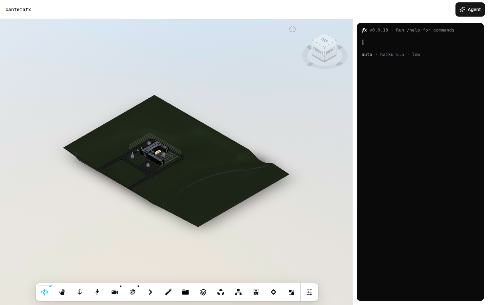
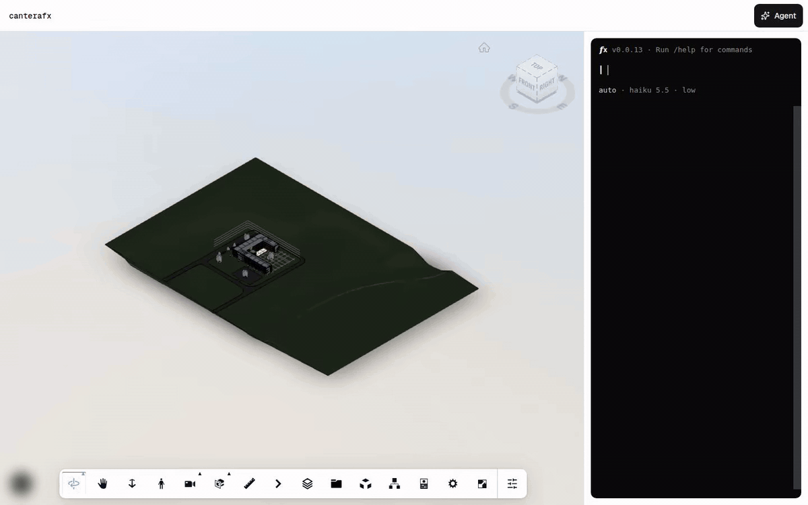

# canterafx



An already-translated model in a full-bleed Autodesk Viewer with the fx coding agent docked beside it as a terminal. libfx runs in the browser, a sandboxed bash workspace gives fx a viewer command over a typed tool catalog, model traffic goes through a same-origin AI Gateway proxy, and a colour legend explains what the agent paints.

[](https://vercel.com/new/clone?repository-url=https%3A%2F%2Fgithub.com%2Fmrestrepoj10%2Fcantera%2Ftree%2Fmain%2Ftemplates%2Fmodel-agent-page&project-name=cantera-model-agent-page&repository-name=cantera-model-agent-page&env=APS_CLIENT_ID%2CAPS_CLIENT_SECRET%2CAPS_MODEL_URN%2CAI_GATEWAY_API_KEY&envDescription=The+keys+this+template+needs.+The+README+explains+each+one.&envLink=https%3A%2F%2Fcanteraui.vercel.app%2Fcomponents%2Fmodel-agent-page)

The deploy prompts for the keys marked required below.

## See it work



[Watch the full-resolution recording](docs/session.webm).

## Run locally

```sh
pnpm install
cp .env.example .env.local
pnpm dev
```

Then open /agent. The home route redirects there.

## Environment

| Key | Required | Meaning |
| --- | --- | --- |
| `APS_CLIENT_ID` | yes | Client ID of your APS app (aps.autodesk.com). |
| `APS_CLIENT_SECRET` | yes | Client secret of the same APS app. |
| `APS_MODEL_URN` | yes | Base64 Model Derivative URN of a model Autodesk has already translated, with or without the urn: prefix. |
| `AI_GATEWAY_API_KEY` | yes | Vercel AI Gateway key, held by the /api/agent/gateway proxy route and never sent to the browser. Only anthropic/claude-haiku-5.5 is allowed through. |

## What is inside

Routes and handlers:

- `app/agent/loading.tsx`
- `app/agent/page.tsx`
- `app/api/agent/gateway/[...path]/route.ts`
- `app/api/viewer-token/route.ts`

Components and libraries:

- `components/model-agent.tsx`
- `components/ui/aps-viewer/aps-viewer.tsx`
- `components/ui/aps-viewer/context.ts`
- `components/ui/aps-viewer/extensions.tsx`
- `components/ui/aps-viewer/hooks.ts`
- `components/ui/aps-viewer/index.ts`
- `components/ui/aps-viewer/loader.ts`
- `components/ui/aps-viewer/settings.tsx`
- `components/ui/aps-viewer/store.ts`
- `components/ui/aps-viewer/toolbar.ts`
- `components/ui/badge.tsx`
- `components/ui/button.tsx`
- `components/ui/checkbox.tsx`
- `components/ui/fx-terminal/fx-terminal.tsx`
- `components/ui/fx-terminal/images.ts`
- `components/ui/fx-terminal/index.ts`
- `components/ui/fx-terminal/runtime.ts`
- `components/ui/fx-terminal/workspace.ts`
- `components/ui/sheet.tsx`
- `components/ui/token-status.tsx`
- `lib/agent-types.ts`
- `lib/forge-viewer.d.ts`
- `lib/libfx-browser.d.ts`
- `lib/oauth-types.ts`
- `lib/status-tokens.ts`
- `lib/utils.ts`
- `lib/viewer-agent-core.ts`
- `lib/viewer-agent-display.ts`
- `lib/viewer-agent-inspect.ts`
- `lib/viewer-agent-query.ts`
- `lib/viewer-agent-state.ts`
- `lib/viewer-agent-tools.ts`
- `lib/viewer-extension-types.ts`
- `lib/viewer-types.ts`

## Keep it current

This directory is generated from the cantera registry by `pnpm registry:build`; edit the
registry sources, not these files. The same code installs into an existing app with
`npx shadcn@latest add @cantera/model-agent-page`. Reference: https://canteraui.vercel.app/components/model-agent-page
